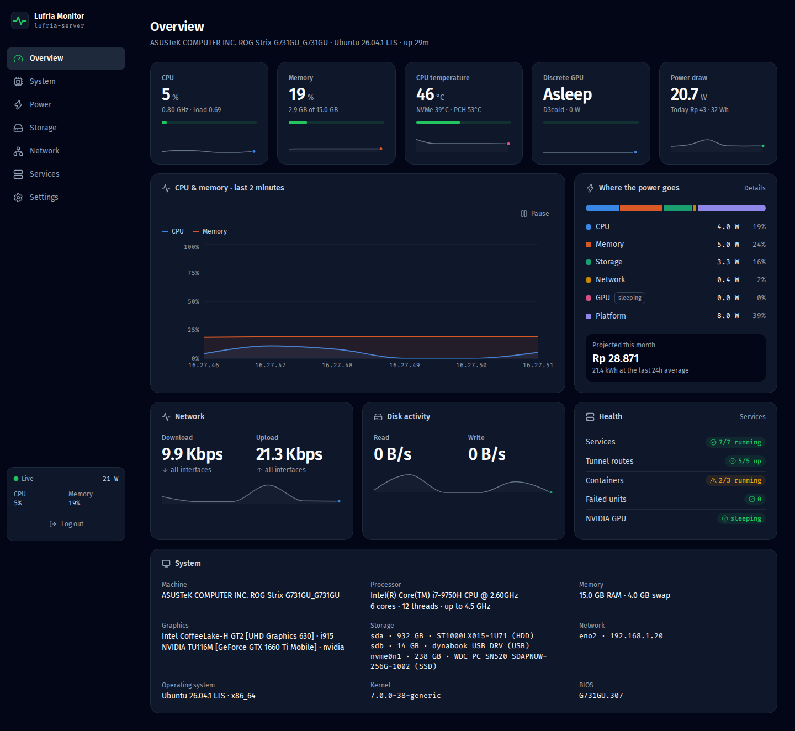
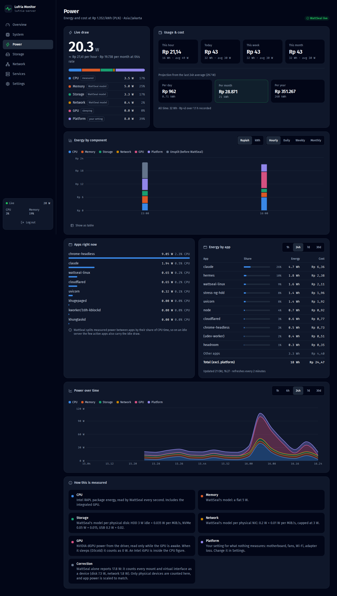
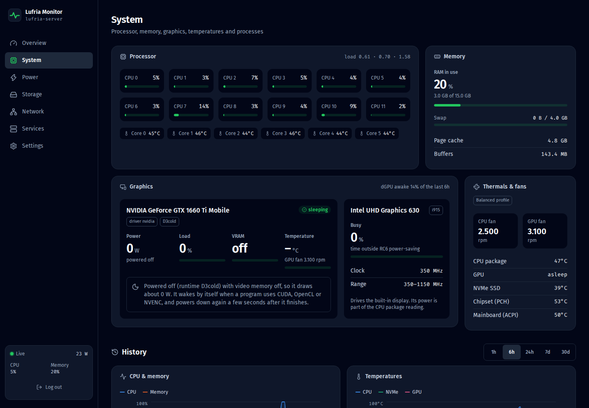
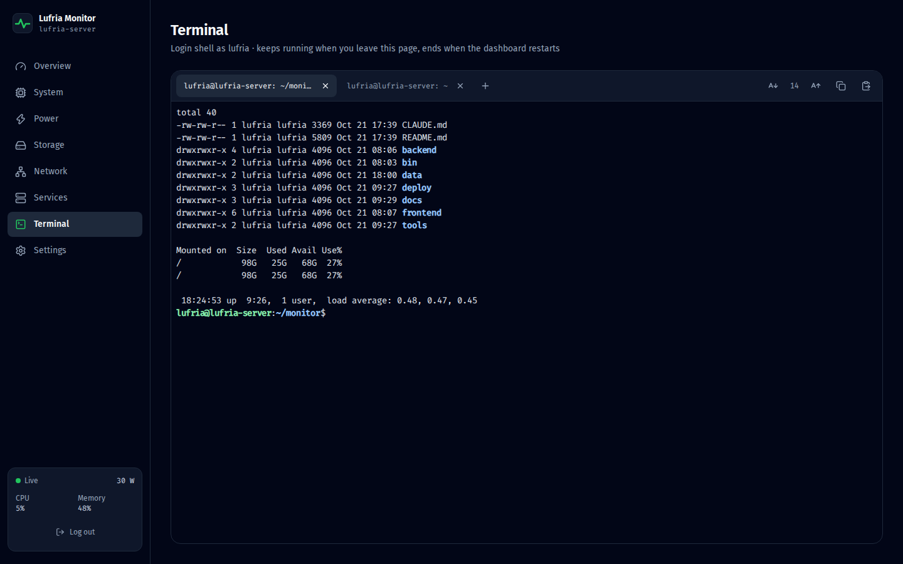
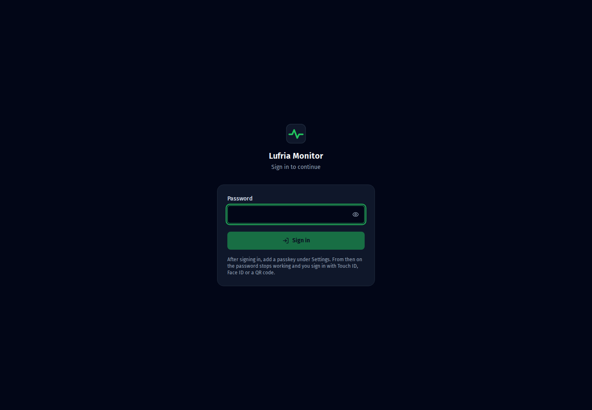

# Lufria Monitor

A self-hosted monitoring dashboard for a single Linux home server: live CPU, memory, GPU, temperatures,
fans, storage health, network and internet speed, service health, and **how much electricity the box
uses, in kWh and Indonesian Rupiah** (PLN tariffs), per hour, day, week and month, down to the app.

Built for an old gaming laptop turned server (ASUS ROG Strix, i7-9750H + GTX 1660 Ti), but nothing in it
is specific to that machine.



| Power and cost | Graphics, thermals and fans |
|---|---|
|  |  |
| **Terminal** | **Sign-in: passkey or QR** |
|  |  |

## Features

- **Live dashboard** over WebSocket, refreshed every second, with per-minute history kept for 400 days.
- **Power and cost**
  - Live watts split by component: CPU (measured with RAPL), RAM, storage, network, GPU and a configurable platform overhead.
  - kWh and Rupiah for this hour, today, this week and this month, plus hourly, daily, weekly and monthly charts and day/month/year projections.
  - PLN tariff presets (R-1 450 VA to R-3), a custom rate and PPJ tax.
  - **Per-app energy**, using [WattSeal](https://github.com/Daminoup88/WattSeal) as the power collector.
- **GPU**
  - NVIDIA dGPU power, load, VRAM, temperature, clocks and the processes using it, plus Intel iGPU busy % and clocks.
  - The monitor never wakes a sleeping dGPU. [Why that matters](docs/nvidia-gpu.md).
- **System:** per-core CPU, memory and swap, temperatures, fan RPM, ASUS power profile, top processes.
- **Storage:** filesystem usage and SMART health (wear, power-on hours, reallocated sectors) for every disk.
- **Network:** per-interface throughput and scheduled Ookla speed tests with history.
- **Services:** watched systemd units, Docker containers, and Cloudflare Tunnel routes with backend checks.
- **Terminal:** a login shell in the browser (xterm.js). [Details](docs/terminal.md).
  - Up to 8 tabs; sessions keep running across page reloads and dropped connections, and replay what you missed.
  - Copy and paste everywhere: Ctrl+C/Ctrl+V (⌘C/⌘V on a Mac), Copy/Paste buttons for phones, a selectable
    scrollback view, and OSC 52 so drag-to-copy works inside apps like Claude Code, tmux and vim.
  - Adjustable text size, and extra keys (Esc, Tab, Ctrl, arrows) for phone keyboards.
  - It runs as the dashboard's user, so anyone who can sign in gets that user's shell.
- **Login:** passkeys only (Touch ID, Face ID, or any phone/security key), or a QR code on the login screen that
  you approve with a passkey on your phone. A password (PBKDF2) only bootstraps the first passkey and is refused
  after that. Signed session cookie, brute-force lockout and a one-time recovery link from the server's CLI.
  [Details](docs/authentication.md).
- **Responsive:** dark UI with phone and desktop layouts.

## How it fits together

```
wattseal.service (root, headless)
  WattSeal -> /opt/wattseal/power_monitoring.db  (per second: CPU/RAM/disk/net energy + per-app)
        |
lufria-monitor-helper.service (root)            lufria-monitor.service (your user, :8090)
  RAPL + WattSeal live  -> power.json  (1 s)  ->  FastAPI sampler (1 s) -> WebSocket /ws/live
  WattSeal per-app      -> apps.json   (2 min)    per-minute rows -> data/monitor.db (SQLite)
  smartctl              -> smart.json  (30 min)   REST /api/*, serves the React build
  /run/lufria-monitor/                            speed test scheduler, GPU reader (sysfs + nvidia-smi)
```

Root-only data (RAPL energy counters, SMART, WattSeal's database) is read by a small root helper and
published as world-readable JSON. The web app itself runs as an unprivileged user.

**Stack:**
- Backend: Python 3.12+ (FastAPI, psutil, SQLite).
- Frontend: React 19, Vite, TypeScript, Tailwind CSS 4, Recharts, xterm.js, Lucide icons, Fira Sans and Fira Code (self-hosted).

## Quick start

On Ubuntu 24.04 or newer:

```bash
sudo apt install python3-venv nodejs npm smartmontools
git clone https://github.com/Enricko/lufria-monitor.git ~/monitor && cd ~/monitor

deploy/bootstrap.sh                          # sets up .env, example data, backend venv + frontend build
(cd backend && .venv/bin/python -m app.auth set)   # bootstrap password, only until the first passkey
deploy/install-speedtest.sh                  # optional: Ookla CLI into ./bin
sudo deploy/install-wattseal.sh              # recommended: power collector (+ GTK3 runtime libs)
sudo deploy/install.sh                       # root helper + dashboard as systemd services
```

Then open `http://<server-ip>:8090` and sign in with the bootstrap password. Expose it over HTTPS, set
`MONITOR_ORIGIN`, and add a passkey in **Settings → Sign-in**: from then on the password is refused.
The full walkthrough is in [docs/setup.md](docs/setup.md). It covers Cloudflare Tunnel, passkeys, NVIDIA
laptops, updating, uninstalling and troubleshooting.

## Documentation

| | |
|---|---|
| [docs/setup.md](docs/setup.md) | Install, expose through Cloudflare Tunnel, add a passkey, update, uninstall, troubleshooting |
| [docs/configuration.md](docs/configuration.md) | Settings, environment variables, files, services, backups |
| [docs/authentication.md](docs/authentication.md) | Passkeys, QR sign-in, recovery, sessions, lockout, hardening |
| [docs/terminal.md](docs/terminal.md) | The browser terminal: sessions, copy and paste, OSC 52, text size, security |
| [docs/power-model.md](docs/power-model.md) | How watts, kWh, Rupiah and per-app energy are computed |
| [docs/nvidia-gpu.md](docs/nvidia-gpu.md) | NVIDIA laptop GPUs: making them sleep at 0 W, and not waking them |
| [docs/api.md](docs/api.md) | REST and WebSocket API |
| [docs/development.md](docs/development.md) | Running locally, project layout, conventions, adding pages and metrics |

## Repository layout

```
backend/    FastAPI app (app/main.py), sign-in (auth.py), terminal (terminal.py), collectors, energy math
frontend/   React app (src/pages, src/components, palette.ts = validated chart colors)
deploy/     systemd units, root helper, installers (bootstrap, install, WattSeal, speedtest, NVIDIA)
tools/      stress-test.sh + gpu_burn.py, to watch the dashboard under full load
docs/       guides and screenshots
```

## Credits

- [WattSeal](https://github.com/Daminoup88/WattSeal) (GPL-3.0) collects the power data. It is installed
  from its official release and is not bundled here. This project re-applies WattSeal's published
  disk, network and GPU power formulas and cites them in [docs/power-model.md](docs/power-model.md).
- [Ookla Speedtest CLI](https://www.speedtest.net/apps/cli) runs the internet speed tests. It is downloaded
  by `deploy/install-speedtest.sh` because Ookla's license does not allow redistributing it.

## License

[MIT](LICENSE)
